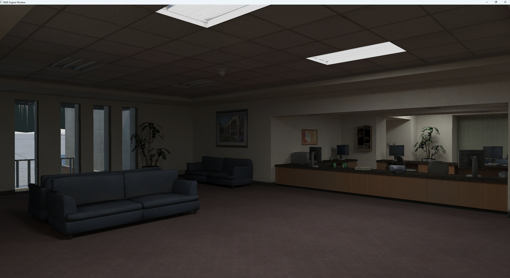
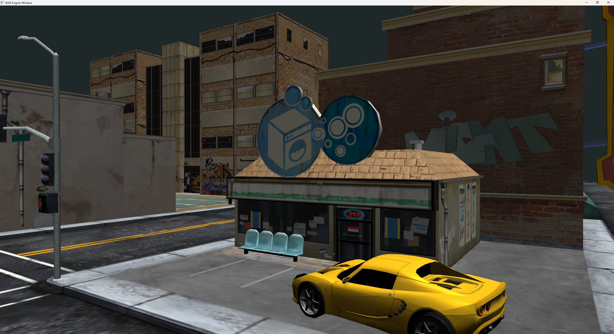

# BiGE

A small hobby rendering engine and world editor written in modern C++.

BiGE is a personal project built for the fun of it: an OpenGL renderer, a world editor for building maps, and a small game on top to keep the engine honest. It isn't trying to compete with commercial engines, but it does load large glTF scenes (millions of triangles) and lets you fly around them.




## Features

- **glTF scenes** – loads glTF 2.0 models, including large, map-sized scenes
- **World editor** – place objects in a map and adjust the environment, including sun position and intensity
- **Free-fly camera** – move around and inspect scenes
- **One-step setup** – all dependencies are included as submodules and built automatically by CMake
- **Tests** – unit tests with Catch2

## Building

Requirements: a C++20 compiler and CMake 3.25 or newer.

```bash
git clone --recursive https://github.com/andrej-bratoz/BiGE.git
cd BiGE
cmake -B build
cmake --build build
```

If you already cloned without `--recursive`, fetch the submodules with:

```bash
git submodule update --init --recursive
```

No manual dependency installation is needed: the build compiles and wires up all third-party libraries on its own.

## Project structure

| Folder | Contents |
| --- | --- |
| `bige-engine` | The engine: rendering, scene and asset loading |
| `bige-editor` | The world editor |
| `bige-games/badv` | A small game built on the engine (ToDo :) )|
| `bige-tests` | Unit tests |
| `ext` | Third-party dependencies (git submodules) |

## Dependencies

[GLFW](https://www.glfw.org/), [glad](https://github.com/Dav1dde/glad), [GLM](https://github.com/g-truc/glm), [tinygltf](https://github.com/syoyo/tinygltf), [nlohmann/json](https://github.com/nlohmann/json), [Dear ImGui](https://github.com/ocornut/imgui), [stb](https://github.com/nothings/stb) and [Catch2](https://github.com/catchorg/Catch2). See [ATTRIBUTIONS.md](ATTRIBUTIONS.md) for details.

## Roadmap

- [ ] Scene/map serialization (packed blobs with assets and metadata)
- [ ] More editor tooling
- [ ] Get it to compile outside Windows
- [ ] Cleanup CMake

## License

MIT – see [LICENSE](LICENSE).
